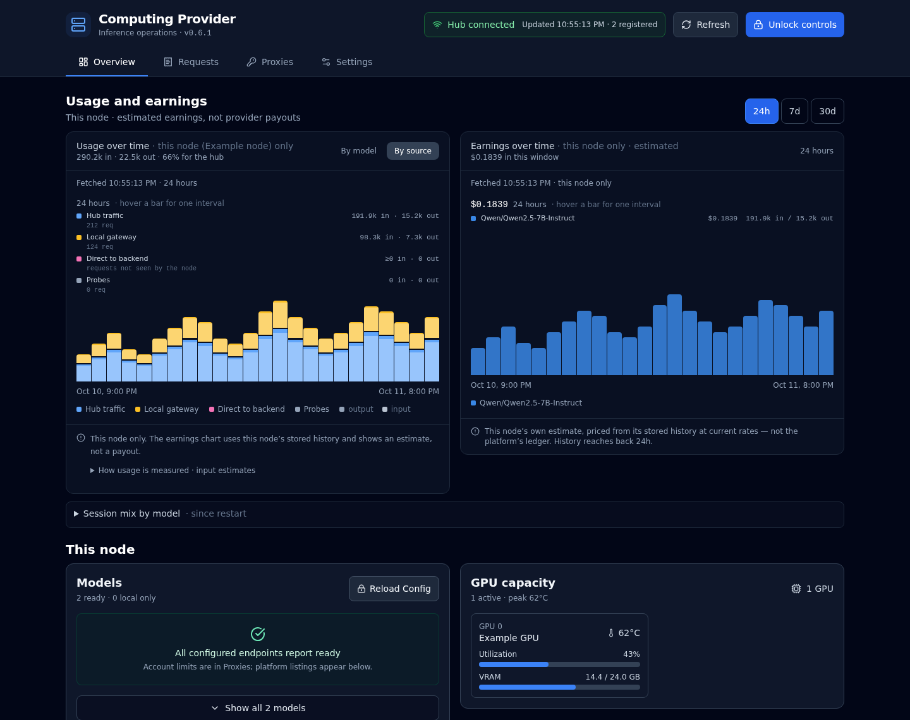

# Computing Provider

[](https://discord.gg/Jd2BFSVCKw)
[](https://x.com/swan_chain)

Turn your GPU — or a subscription-backed model proxy — into a paid inference
endpoint on the [Swan Inference](https://inference.swanchain.io) marketplace.

Latest release: [v0.7.0](https://github.com/swanchain/computing-provider/releases/tag/v0.7.0).



<sub>Illustrative dashboard with example values; your node's data appears when you run the provider.</sub>

- **No wallet, no blockchain registration, no public IP.** The provider dials
  out to Swan Inference over a WebSocket, so it works behind NAT.
- **Paid per token** for every request you serve.
- **Runs your model servers for you** — llama.cpp, vLLM or SGLang in Docker, or
  Ollama on a Mac — and tells you when one stops earning.

## Contents

- [Quick start](#quick-start)
- [From connected to earning](#from-connected-to-earning)
- [How it works](#how-it-works)
- [Configuration](#configuration)
- [Running model servers](#running-model-servers)
- [Subscription-backed models](#subscription-backed-models)
- [Local gateway](#local-gateway)
- [Monitoring](#monitoring) — self-check, alerts, dashboard
- [Automation](#automation) — agent and auto-switch
- [REST API](#rest-api)
- [Getting paid](#getting-paid)
- [CLI reference](#cli-reference)
- [Documentation](#documentation) · [Troubleshooting](#troubleshooting) · [Getting help](#getting-help)

---

## Quick start

### 1. Install

```bash
# Linux x86-64 — also computing-provider-linux-arm64, computing-provider-darwin-arm64
curl -fL -o computing-provider \
  https://github.com/swanchain/computing-provider/releases/latest/download/computing-provider-linux-amd64
chmod +x computing-provider && sudo mv computing-provider /usr/local/bin/

computing-provider version
```

Building from source is optional — see
[installation.md](docs/installation.md#building-from-source).

### 2. Start a model server

**Linux (NVIDIA GPU)** — needs Docker with the
[NVIDIA Container Toolkit](docs/installation.md#install-nvidia-container-toolkit):

```bash
computing-provider models download Qwen/Qwen2.5-7B-Instruct
computing-provider models serve --backend sglang Qwen/Qwen2.5-7B-Instruct
```

`models serve` starts the server in a container, waits until the model is
actually loaded, and adds it to `models.json`. Already running your own server?
Keep it — the next step finds it. See [Running model servers](#running-model-servers).

**macOS (Apple Silicon)**:

```bash
brew install ollama
ollama serve &
ollama pull qwen2.5:7b
```

### 3. Set up and run

```bash
computing-provider setup             # account, config, and model discovery
computing-provider run               # start serving
computing-provider inference status  # confirm you are connected
```

The wizard checks prerequisites, creates or logs into your Swan Inference
account, discovers running model servers, matches them to catalog model IDs,
and writes `config.toml` and `models.json`. Start your model server **first**,
or it will have nothing to find.

> **Earnings come from traffic, not hardware.** Qwen 2.5 7B is only an example.
> Models with demand and few providers route more requests to you —
> `computing-provider inference recommend-models` ranks the catalog against your
> GPU. See [models.md](docs/models.md).

---

## From connected to earning

Your provider moves through these stages on its own; most are fully active
within a day.

```
Connect ──▶ Benchmark ──▶ Approval ──▶ Collateral ──▶ Active
(instant)   (automatic)   (< 24 hrs)   (USD or crypto) (earning)
```

| Stage | What happens | Time |
|-------|-------------|------|
| **Connect** | The provider connects and registers its models | Immediate |
| **Benchmark** | Automated benchmarks verify your hardware can serve them | Minutes |
| **Approval** | An admin reviews your provider | < 24 hours |
| **Collateral** | Deposit to secure your position and unlock earnings — card, USDC on Ethereum or Base, or SWAN on Swan Chain | Instant |
| **Active** | Requests arrive and you earn | Ongoing |

> **Grace period:** for 7 days after activation, benchmark failures and low
> uptime do not affect routing priority, so you have time to stabilise.

`computing-provider inference status` shows your current stage at any time.

---

## How it works

```
                 Swan Inference (cloud)
                          │
                          │  WebSocket — outbound only, works behind NAT
                          ▼
┌────────────────────────────────────────────────────────┐
│ Computing Provider                                     │
│                                                        │
│  health checks · rate & concurrency limits · retries   │
│                                                        │
│  local gateway :9088 ◀── your own scripts and agents   │
│  dashboard     :3060                                   │
└──────────────┬─────────────────────────┬───────────────┘
               ▼                         ▼
     GPU model servers           subscription proxy
  (llama.cpp, vLLM, SGLang,         (CLIProxyAPI)
         Ollama)
```

1. The provider connects **outbound** to Swan Inference — no inbound ports.
2. It registers the models in `models.json`.
3. Requests — chat, image, embedding and transcription — arrive over the WebSocket.
4. Each is forwarded to the model's server and the response streamed back.
5. You are **paid per token** for completed requests.

Request flow needs no tuning to run. Endpoints are health-checked continuously
and unhealthy ones leave routing until they recover; GPU-aware rate limits and
per-model concurrency slots answer excess work with HTTP 429 instead of
overloading the GPU; transient upstream failures are retried with backoff;
`models.json` edits hot-reload; and SIGTERM/SIGINT drains cleanly. Limits can be
retuned at runtime over the [REST API](#rest-api).

---

## Configuration

Two files in `$CP_PATH` (default `~/.swan/computing`), both written by
`computing-provider setup`.

**`config.toml`** — provider settings:

```toml
[API]
Port = 8085
NodeName = "my-provider"

[Inference]
Enable = true
WebSocketURL = "wss://inference-ws.swanchain.io"
ApiKey = "sk-prov-xxxxxxxxxxxxxxxxxxxx"   # from https://inference.swanchain.io
Models = ["Qwen/Qwen2.5-7B-Instruct"]
```

**`models.json`** — catalog model IDs mapped to the servers that run them:

```json
{
  "Qwen/Qwen2.5-7B-Instruct": {
    "endpoint": "http://localhost:30000",
    "gpu_memory": 16000,
    "category": "text-generation"
  }
}
```

| Field | Purpose |
|-------|---------|
| `endpoint`, `api_key` | The model server, and a bearer key if it needs one |
| `local_model` | The name the server knows the model by, when it differs from the catalog ID (`qwen2.5:7b` on Ollama, `gpt-5.5` on a proxy) |
| `category` | `text-generation`, `image-generation`, `embedding` or `transcription` |
| `context_length` | The real context window — set it for anything but vLLM and SGLang |
| `local_endpoint`, `local_api_key` | A separate backend for the [local gateway](#local-gateway) |
| `local_only` | Serve through the local gateway only; never offered on the marketplace |

Every field, plus alerts, self-check, dashboard and logging settings, is in
[configuration.md](docs/configuration.md).

> **Serving from Ollama, llama.cpp, LiteLLM or a proxy?** Set `context_length`.
> Only vLLM and SGLang expose their real window; otherwise the marketplace
> advertises the catalog's theoretical value and clients send prompts your
> backend rejects. See [context windows](docs/configuration.md#context-windows).

---

## Running model servers

```bash
computing-provider models serve --backend llamacpp \
  --weights /models/Qwen3.8-27B-UD-Q4_K_S.gguf --gpus 2,3 \
  --context-length 65536 --port 30001 \
  Qwen/Qwen3.8-27B --parallel 2 -fa on

computing-provider models ps                      # servers this tool started
computing-provider models stop --rm Qwen/Qwen3.8-27B
computing-provider models memory                  # what each model really used here
```

Backends are `llamacpp` (a `.gguf` file), `vllm` and `sglang` (a model
directory). Flags go before the model ID; anything after it is passed straight
to the server. `--dry-run` prints the `docker run` command instead.

- **Your own containers are safe.** Only containers this tool labelled are
  listed or stopped, and it refuses to start a model that something else is
  already serving.
- **Loopback only.** Servers are published on `127.0.0.1`, since they have no
  authentication of their own.
- **Ready means loaded.** It waits until the model is listed, not just until the
  port answers.
- **It remembers what worked.** Measured VRAM and the exact command for each
  model are kept in `$CP_PATH/model-memory.json` and `cp.md`.

Starting or stopping a model sends an alert saying who did it and why.

---

## Subscription-backed models

[CLIProxyAPI](docs/guides/cliproxy-computing-provider.md) turns a ChatGPT,
Claude or Gemini subscription into an OpenAI-compatible endpoint. Point a model's
`endpoint` at it like any other server; the provider can check and renew its
logins:

```bash
computing-provider cliproxy status           # account, plan and expiry per credential
computing-provider cliproxy status --probe   # and one real completion per model
computing-provider cliproxy login --device   # re-authenticate; prints a code and a URL
computing-provider cliproxy prune            # disable logins that can no longer refresh
```

`status` reads credential metadata only — never a token — and exits non-zero on
an expired or disabled login, so it works as a cron check.

**Use `--probe`.** A login can be unexpired and enabled yet still rejected
upstream, and the proxy answers `/v1/models` from a static list either way — so
the model looks healthy while every request fails. Only a real completion tells
them apart:

```
  expiring  codex   you@example.com (plus)   expires 2026-09-08 (in 128h0m0s)

Live probe
  HTTP 503  gpt-5.5
            auth_unavailable: no auth available (providers=codex, model=gpt-5.5)
```

That credential is not expired, so re-authenticating will not help — check
whether the account still has access.

### Hub proxy and local proxy

Run two CLIProxyAPI instances, each logged in to a **different account**:

| | Serves | Port (example) | models.json field |
|---|---|---|---|
| **Hub proxy** | marketplace requests from Swan Inference | `8317` | `endpoint` |
| **Local proxy** | your own tools, through the [local gateway](#local-gateway) | `8318` | `local_endpoint`, or `endpoint` on a `local_only` model |

Your own scripts and agents then never spend the quota that marketplace traffic
depends on, and a busy benchmark cannot rate-limit routed work.

1. Start the second proxy from its own directory, with its own `config.yaml`,
   `port`, `api-keys` and auth directory, and log it in to the second account.
2. Map models to the two proxies in `models.json`:

   ```json
   {
     "openai/gpt-5.5": {
       "endpoint": "http://127.0.0.1:8317",
       "api_key": "<hub proxy's key>",
       "local_endpoint": "http://127.0.0.1:8318",
       "local_api_key": "<local proxy's key>",
       "local_model": "gpt-5.5"
     },
     "anthropic/claude-sonnet-5-5": {
       "endpoint": "http://127.0.0.1:8318",
       "api_key": "<local proxy's key>",
       "local_model": "claude-sonnet-5-5",
       "local_only": true
     }
   }
   ```

   `openai/gpt-5.5` is offered on the marketplace through the hub proxy, and the
   same model name on the gateway goes to the local proxy instead.
   `claude-sonnet-5-5` is for your own use only.
3. Point your clients at the gateway, not at either proxy:

   ```bash
   export OPENAI_BASE_URL=http://127.0.0.1:9088/v1   # any API key is accepted
   curl $OPENAI_BASE_URL/chat/completions -H 'Content-Type: application/json' \
     -d '{"model":"openai/gpt-5.5","messages":[{"role":"user","content":"hi"}]}'
   ```

   Calling the local proxy directly works too, but the node then sees the work
   only as `direct` usage in the proxy's counters, not as `local` requests.

**Only hub models are health-checked.** Health probes are real completions, so
they run only against `endpoint` on models offered to the marketplace. The local
proxy, and every `local_only` model, are never probed: the dashboard shows their
state from the last request the gateway sent them ("last request answered",
"last request failed", "no requests yet"). A failing local route is a warning,
never a reason to stop serving marketplace traffic.

`"local_only": true` keeps a model off the marketplace entirely: it is never
registered, requests for it from Swan Inference are refused, and it is never
sent a probe completion. **Leaving a model out of `config.toml` is not enough** —
a `models.json` reload registers every ready model, whatever `[Inference] Models`
says.

For the dashboard's **Proxies** tab — accounts, quota, per-model token use — set
`[Inference] CLIProxyManagementKey` to the proxies' management `secret-key`, and
in each proxy's `config.yaml` set `usage-statistics-enabled: true` and
`redis-usage-queue-retention-seconds` to a few minutes.
The key is only ever sent to proxies on this machine (`localhost` or a loopback
address); a remote endpoint is never given it.

---

## Local gateway

Your own clients — scripts, agents, benchmarks — can use the models this node
serves through an OpenAI-compatible endpoint:

```bash
export OPENAI_BASE_URL=http://127.0.0.1:9088/v1   # any API key is accepted
```

| Route | |
|---|---|
| `POST /v1/chat/completions` | Chat, streaming or not |
| `POST /v1/images/generations` | Image models |
| `POST /v1/embeddings` | Embedding models |
| `POST /v1/audio/transcriptions` | Speech to text, standard multipart upload |
| `GET /v1/models` | Every model the gateway can reach, including `local_only` ones |

```bash
curl http://127.0.0.1:9088/v1/audio/transcriptions \
  -F model=openai/gpt-4o-transcribe -F file=@recording.wav -F response_format=text
```

Requests go to the same backends, or a model's `local_endpoint`, and show on the
dashboard as `local` traffic — so a benchmark holding a GPU for hours no longer
looks like an idle model. They bypass the rate and concurrency limits that
protect marketplace work, and never count towards earnings.

- **Loopback only, no authentication.** Change the port with
  `[Inference] LocalGatewayPort`; `-1` disables the gateway.
- **Transcription works through a ChatGPT-subscription proxy too.** The node runs
  it through a realtime session, since those proxies have no plain
  transcription endpoint.
- **Audio formats.** WAV is decoded directly; MP3, M4A and others need `ffmpeg`
  on `PATH` and are refused without it.

---

## Monitoring

### Self-check

The failures that cost money are quiet: the daemon stays up and looks healthy
while a model earns nothing. `computing-provider selfcheck` audits for exactly
that.

```
  OK   models.json                     8 models mapped
  OK   config/models.json agreement    config.toml and models.json list the same models
  OK   Swan Inference connection       connected
  OK   registered with Swan Inference  all 8 models registered
  OK   model health                    all 8 models healthy
  OK   context window                  reported context matches every backend
 FAIL  inference probe                 openai/gpt-5.5: HTTP 401 authentication token has been invalidated
  OK   traffic                         every model has served requests
  OK   disk space                      /home/you/.swan/computing: 92.1 GB free of 438 GB (78% used)
```

It finds what no error message shows:
- a model served but not advertised, or advertised but never registered;
- a backend serving less context than you claim;
- a backend that answers health checks but cannot serve;
- a model that has never been called;
- a disk about to fill.

The inference probe sends one `max_tokens: 1` completion per model. It is the
only check that exercises the engine; most backends answer `GET /v1/models`
without touching it, so a dead engine or an expired API token looks healthy
everywhere else.

It exits non-zero on failure, so it works as a cron or monitoring check (`--json`
for machine-readable output, `--no-inference` to skip the probe).

The daemon runs the same audit every 10 minutes and acts on it: a model whose
backend fails two probes in a row is **deregistered** and re-registered once it
serves again — no traffic beats traffic that fails. Only backend-owned failures
count: an over-long prompt or your own rate limit never pulls a model, and one
you disabled by hand is never switched back on. Tune it under `[SelfCheck]`; see
[configuration.md](docs/configuration.md#self-check-and-auto-heal).

### Alerts

Point the provider at a webhook, an SMTP server, or both:

```toml
[Alerts]
WebhookURL = "https://hooks.example.com/provider"

[Alerts.Email]
Host = "smtp.gmail.com"
Port = 587
Username = "you@example.com"
To = ["you@example.com"]
```

Keep the password out of `config.toml` — the provider reads `$CP_PATH/.env` at
startup:

```bash
# Gmail, Outlook and Yahoo need an app password, not your login password
umask 077 && printf "SMTP_PASSWORD='your-app-password'\n" > $CP_PATH/.env
computing-provider alerts test    # verify before you need it
```

You are told when:
- a model goes unhealthy, or passes health checks while failing most requests;
- the connection to Swan Inference is lost;
- a self-check fails.

Each has a matching recovery. Passing runs are logged locally, never sent, so an
"all clear" never trains you to ignore mail.

Swan Inference can also send notices about things a node cannot see about itself
— a reputation drop, withheld traffic, a rejected model declaration. They arrive
through the same transports, prefixed `hub_`. Payloads and tuning are in
[configuration.md](docs/configuration.md#alerts).

### Dashboard

```bash
computing-provider dashboard    # http://localhost:3060
```

| Tab | What it shows |
|-----|---------------|
| **Overview** | Usage and estimated earnings for this node, model and GPU readiness, and anything that needs attention |
| **Requests** | Every request: where it came from, outcome, latency and tokens |
| **Proxies** | A 24-hour token chart per proxy (marketplace and local), each proxy's accounts with status and subscription limits, and model routing |
| **Settings** | Configuration, request limits, alerts, self-check and logging |

- **Usage is split by source:** marketplace traffic, local-gateway clients,
  work sent straight to a backend, and probes. Charts cover 24 hours, 7 days or
  30 days, for **this node only**.
- **Earnings are an estimate** at current rates, shown beside the platform's own
  figure when it can be read. For settled, account-wide earnings use the
  [provider dashboard](https://inference.swanchain.io/dashboard).
- **Needs attention** flags mismatches, such as a registered model the platform
  does not list as offered.
- **Subscription limits** appear only when the upstream reports them. Claude's do
  not reach the proxy, so check [Claude usage](https://claude.ai/settings/usage).

The dashboard is read-only until you choose **Unlock controls** and paste the
token from `$CP_PATH/dashboard.token`, an owner-only file created on first run.
Stored secrets are never sent to the browser. Host and port are set under
`[Dashboard]`; use `0.0.0.0` only on a network you trust. For development on
your own machine, `computing-provider run --no-auth` drops the token: loopback
bind only, and every local user can then control the node.

---

## Automation

**Ask the node a question.** `computing-provider agent "<goal>"` hands a
plain-language goal to a model this node already serves, with a fixed set of
tools:

```bash
computing-provider agent "why did earnings drop yesterday?"
computing-provider agent --allow-actions "stop the model that is not earning"
```

It has no shell and cannot call anything outside its tools. It is read-only
unless you pass `--allow-actions`, and even then every change goes through the
same guardrails a person would hit. An answer with no observed evidence behind
it is refused, and every step is printed.

**Let it choose models.** `computing-provider inference plan` runs one
auto-switch cycle — which models would earn more on this hardware — and prints
the decision without acting. Set `[Inference.AutoSwitch] Enable = true` to let
it act.

A language model proposes; ordinary code decides. A plan is refused whole if any
rule fails, including:
- the model does not fit in VRAM, or its size cannot be known;
- the gain is below your margin;
- the switch would stop a model you pinned;
- the node has switched too recently or too often today.

It never downloads weights on its own.

---

## REST API

```bash
curl http://localhost:8085/api/v1/computing/inference/status
```

All paths are under `/api/v1/computing`.

| Endpoint | Description |
|----------|-------------|
| `GET /inference/status` | Connection state, active models, what is registered upstream |
| `GET /inference/metrics` | Request counts, latency, GPU stats (`/metrics/prometheus` for Grafana) |
| `GET /inference/usage/history?duration=24h` | Usage by source; also `7d` and `30d` |
| `GET /inference/earnings/history?duration=24h` | Earnings history; `scope=node` for this node's own estimate |
| `GET /inference/proxy-accounts` | Proxy instances, accounts, quota windows and per-model token use |
| `GET /inference/models` | Every model with its status |
| `GET /inference/health` | Health of every model |
| `POST /inference/models/:id/enable` · `/disable` | Take a model in or out of service |
| `POST /inference/models/reload` | Hot-reload `models.json` |

Rate and concurrency limits can be read and changed at runtime under
`/inference/ratelimit` and `/inference/concurrency`. A model's own limits are
`max_concurrent` and `rpm` in its `models.json` entry — editable from the
model's row in the dashboard — and `max_concurrent` is what the hub is told
the model can take.

---

## Getting paid

You are paid **per token, for every request you serve**. Each catalog model
publishes a payout price per 1M input and output tokens; earnings accrue at that
rate and appear in the [provider dashboard](https://inference.swanchain.io/dashboard)
and in `computing-provider inference status`. Idle hardware earns nothing — the
Swan 1.0 UBI program has ended — so traffic is the only thing that pays.

```bash
computing-provider inference set-beneficiary 0xYourWalletAddress
```

Request payouts from the dashboard: minimum $10, flat $1 fee, one request per
chain per hour. Earnings can also be converted into inference credit on the same
account.

**Collateral is required for activation.** Deposit on-chain (USDC on Ethereum or
Base, SWAN on Swan Chain) or by card; it is refundable after a 7-day waiting
period.

```bash
computing-provider inference deposit          # chains, contracts, minimums
computing-provider inference deposit --check  # current collateral status
```

---

## CLI reference

```bash
computing-provider setup                     # interactive setup (recommended)
computing-provider run                       # start the provider
computing-provider selfcheck                 # audit this node
computing-provider dashboard                 # web UI on port 3060
computing-provider agent "<goal>"            # ask a local model about this node

computing-provider version                   # installed build
computing-provider update --check            # is a newer release available?
sudo computing-provider update               # install the newest release

computing-provider inference status          # stage, models, earnings, context
computing-provider inference recommend-models
computing-provider inference select-model    # pick a marketplace model interactively
computing-provider inference plan            # one auto-switch cycle, no action
computing-provider inference deposit         # collateral instructions
computing-provider inference set-beneficiary 0x...

computing-provider models catalog            # supported models
computing-provider models download <id>      # fetch weights
computing-provider models list               # what is on disk
computing-provider models serve <id>         # start a server and declare it
computing-provider models ps | stop <id>     # managed servers
computing-provider models memory             # measured VRAM and known-good commands

computing-provider cliproxy status --probe   # subscription-backed models: are they serving?
computing-provider cliproxy login --device   # re-authenticate one

computing-provider alerts test               # send a test alert
computing-provider research hardware         # hardware, GPU info, benchmarks
```

`setup` also takes `--skip-discovery` and `--api-key=sk-prov-xxx`, and has
`discover`, `login` and `signup` subcommands. Full reference in
[docs/cli/](docs/cli/README.md); `--help` works on every command.

Updates are verified against the checksums published with each release, and the
binary is replaced atomically. `update` does **not** restart a running provider
— see [keeping up to date](docs/installation.md#keeping-up-to-date).

---

## Documentation

| Guide | Covers |
|-------|--------|
| [Installation](docs/installation.md) | Requirements, binary install, building from source, updates |
| [Getting started](docs/getting-started.md) | First run, Linux and macOS walkthroughs |
| [Configuration](docs/configuration.md) | `config.toml`, `models.json`, alerts, self-check, dashboard |
| [Models](docs/models.md) | Catalog, VRAM sizing, downloading weights, switching models |
| [SGLang deployment](docs/sglang-deployment.md) | Running SGLang for inference |
| [SGLang tuning](docs/sglang-best-practices.md) | GPU configs, memory tuning, multi-GPU tensor parallelism |
| [Apple Silicon](docs/apple-silicon-support.md) | Ollama on M-series Macs |
| [CLIProxyAPI](docs/guides/cliproxy-computing-provider.md) | Serving a ChatGPT or Claude subscription as an endpoint |
| [Troubleshooting](docs/troubleshooting.md) | Error reference and FAQ |

## Troubleshooting

Start with `computing-provider selfcheck` — it names the problem more precisely
than the logs will. The most common:

| Symptom | Cause |
|---------|-------|
| Online but receiving no requests | `--served-model-name`, the `models.json` key and the catalog ID must all match exactly |
| `invalid provider API key` | Provider keys start with `sk-prov-`; consumer keys (`sk-swan-*`) do not work |
| A proxy model is healthy but every request fails | The subscription login is rejected upstream — run `cliproxy status --probe` |
| A model you meant to keep private appears on the marketplace | Set `"local_only": true`; leaving it out of `config.toml` is not enough |

Full error reference and FAQ: [docs/troubleshooting.md](docs/troubleshooting.md).

## Getting help

- [Discord](https://discord.gg/3uQUWzaS7U) — community support
- [GitHub Issues](https://github.com/swanchain/computing-provider/issues) — bug reports
- [docs.swanchain.io](https://docs.swanchain.io) — full documentation

## License

Apache 2.0
